# Diseño de RPC de catálogo paginado — paso 3

> Estado al 29 de octubre de 2026: consultar la [guía vigente y trazabilidad](CATALOGO-ESTADO-Y-DOCUMENTACION.md). El código del catálogo está publicado como preparación; la 009 no está instalada y el catálogo paginado no está integrado. La edición por ID sí está implementada y publicada. Los resultados y estados Git de cada bloque son evidencia histórica, no pruebas nuevas de esta revisión documental. Este documento sigue pendiente de autorización para commit.

Diseño v1.2 · Revisión documental del 29 de octubre de 2026. **Decisiones de producto aprobadas y preparación publicada; instalación e integración visible no autorizadas**.

Este archivo reúne arquitectura, contrato, índices candidatos, datos cambiantes, permisos, riesgos y plan de pruebas/migración. No es una migración ni una función instalada. No se ejecutó SQL, no se consultó Supabase y no se cambiaron credenciales, respaldos, permisos, código o migraciones. La 008 sigue pendiente y el efectivo y los pagos digitales permanecen deshabilitados. La expansión geográfica no se implementa aquí.

Esta revisión incorpora la aprobación expresa del propietario de las seis decisiones de §11, con una modificación frente a v1: **se permiten búsquedas de dos caracteres; se descarta el mínimo general de tres**. La aprobación original del plan no autorizaba implementación. Después se autorizaron y publicaron los bloques locales P1–P5, incluido el borrador fuera de migrations; no se autorizaron instalación, índices/extensiones, integración visible ni cambios remotos. La propuesta original de tres caracteres queda sustituida, no pendiente de confirmación.

## 1. Base existente y límites

Se revisaron `src/lib/catalog-page.js`, `catalog-page-loader.js`, `public-collections.js`, `src/utils/catalog.js`, las definiciones locales 001–007, la 008 preparada y los documentos de los pasos 1 y 2. La instalación 001–007 se toma del historial confirmado del proyecto; esta revisión no vuelve a consultar sus definiciones remotas. Las diez pruebas remotas anteriores de edición están documentadas en [VERIFICACION-EDICION-POR-ID.md](VERIFICACION-EDICION-POR-ID.md); no se repiten para este diseño.

- El catálogo visible continúa usando `useMarketplace`: descarga productos/subastas y filtra en React. No se sustituye bajo esta autorización.
- El servicio preparado limita páginas a 12 y tiene cursores, cancelación, preservación de páginas y actualizaciones de precio sin mover tarjetas. Rechaza búsqueda no vacía y precio mixto porque todavía no puede resolverlos globalmente.
- `products.price` es el precio publicado/de referencia; en subastas conserva el precio inicial. `auctions.highest_amount` y `bid_count` son el resumen persistido del motor de pujas aceptadas.
- `auctions.product_id` tiene unicidad. Hay índices de productos por propietario, fecha y categoría y de subastas por reloj y vendedor. No se presupone su estado remoto actual sin un diagnóstico autorizado.
- El filtro JavaScript actual usa NFD, elimina marcas U+0300–U+036F y convierte a minúsculas; por tanto equipara también `ñ` y `n`. La distinción entre ñ y n ya está aprobada para el nuevo contrato; está implementada en la referencia, el adaptador y el borrador publicados, pero aún no se aplica al catálogo visible. No se cambia silenciosamente su filtro en esta revisión documental.
- La 008 conserva `product_updated_at`, importes propios y guards que comparan la fila completa. Añadir columnas derivadas o rellenar productos históricos puede interferir con esos guards y los de 005/006. Esta propuesta evita esos cambios.

## 2. Arquitectura propuesta

Una RPC nueva, firma preparada `public.catalog_page_v1(p_request jsonb) returns jsonb`, de lectura. Adaptador React publicado pero aún no integrado, independiente del servicio de escritura y de perfiles/favoritos.

```mermaid
flowchart LR
  UI[Controles del catálogo] --> Q[Consulta normalizada y generación local]
  Q --> RPC[RPC SECURITY INVOKER]
  RPC --> V[Validar parámetros y cursor]
  V --> P[products con RLS]
  V --> A[auctions con RLS]
  P --> F[Campos públicos y precio efectivo]
  A --> F
  F --> S[Buscar y filtrar antes de paginar]
  S --> O[Orden total y cursor]
  O --> L[Límite 12 más una fila]
  L --> DTO[Hasta 12 tarjetas y cursor siguiente]
  DTO --> UI
  RT[Eventos públicos de subastas] --> C[Precio en su sitio y aviso de cambios]
  C --> UI
  UI -->|Actualizar lista explícitamente| Q
```



### 2.1 Seguridad y coherencia de una llamada

- `SECURITY INVOKER`, `STABLE`, `SET search_path = ''`; tablas y helpers cualificados. Sin `SECURITY DEFINER`, SQL dinámico construido con entrada del usuario ni bypass de RLS.
- Validación dependiente solo de parámetros y contexto del llamador; consulta final como una sentencia de lectura. Helpers transitivos también sin efectos secundarios. Declarar STABLE no sustituye revisar sus llamadas.
- Capturar `statement_timestamp()` una vez para `server_time`. Formatear timestamps UTC explícitamente con seis decimales. No depender del TimeZone de sesión para producir cursores.
- Una llamada STABLE utiliza el snapshot de su sentencia. **Eso no conserva un snapshot entre peticiones/páginas**. La hora devuelta no es una versión de catálogo ni permite reconstruir precios anteriores. [Volatilidad y snapshots de PostgreSQL 17](https://www.postgresql.org/docs/17/xfunc-volatility.html).
- Lecturas MVCC normales: sin `FOR UPDATE`, `FOR SHARE`, advisory locks, contadores globales de revisión ni bloqueos del motor comercial. Hay los locks de lectura ordinarios de PostgreSQL; no se promete ausencia absoluta de bloqueo ante DDL.
- No llamar `auction_snapshot`, `settle_auction_locked`, `advance_auction_clock`, crear resultados, emitir notificaciones ni modificar visitas. El catálogo no adjudica.

### 2.2 Relaciones y precio efectivo

Leer únicamente `products`, los campos públicos necesarios de `profiles` y `auctions`. No consultar `auction_bids` para obtener precio: su visibilidad es distinta para vendedor, postor y terceros. Usar el resumen público producido por la RPC de pujas; no `MAX()` sobre un subconjunto privado.

| Modalidad/estado del resumen | Precio de tarjeta | price_kind |
| --- | --- | --- |
| fixed | products.price | fixed_reference |
| offers | products.price | negotiable_reference |
| auction, bid_count = 0 y highest_amount IS NULL | auctions.initial_price | auction_initial |
| auction, bid_count > 0 y highest_amount válido | auctions.highest_amount | auction_highest_valid |

Comprobar correspondencia de product_id y vendedor. Una subasta sin relación visible, con resumen incoherente o precio inválido no se transforma en precio fijo ni vuelve al precio inicial para ocultar una anomalía. Queda fuera de la relación pública elegible **antes de LIMIT**, sin publicar su ID ni un contador de exclusiones. No afirmar si existe una fila oculta por RLS. El diagnóstico de anomalías será una tarea interna separada y autorizada; la RPC no escribe una bitácora por cada lectura.

La relación elegible debe tener una fila por producto: no unir fotos, historial, mensajes o reclamaciones que multipliquen tarjetas. La foto principal ya está en products. Un perfil no visible puede representarse con nombre neutro sin revelar datos adicionales.

Los estados de subastas siguen siendo los persistidos. Por compatibilidad, v1 no añade un filtro automático que quite las finalizadas o canceladas del catálogo actual. Si el plazo venció pero Cron aún no registró el cierre, devolver ese estado y su deadline: el cliente puede mostrar «Verificando cierre», nunca inventar ganador. Se conserva exactamente la regla vigente: una puja válida durante el último minuto, incluido el límite, extiende el deadline previo 120 segundos. Esta RPC no cambia su implementación ni Cron.

### 2.3 Flujo lógico de consulta

1. Validar solicitud; normalizar búsqueda una vez y validar cursor.
2. Aplicar RLS a fuentes y construir filas públicas elegibles/precio efectivo.
3. Aplicar categoría, modalidad, fragmento literal y rango de precio efectivo.
4. Aplicar condición de continuación del orden elegido.
5. Orden total; obtener page_size + 1 filas.
6. Serializar solo las primeras page_size; derivar has_more y cursor de la última devuelta, no de la fila adicional.

Es un orden lógico de resultados, no una promesa de orden físico de evaluación del optimizador. Ningún filtro se pospone a React. El planner puede adelantar predicados seguros; se verificarán planes reales con RLS.

Prever tres ramas de SQL estático según sort, con parámetros enlazados y su ORDER BY específico. Evitar un único ORDER BY CASE que impida aprovechar índices sin medirlo. Comparar también planes genéricos y específicos al variar filtros/selectividad; no forzar globalmente el planner ni deshabilitar escaneos para obtener una cifra favorable.

## 3. Contrato de parámetros y respuestas

Contrato propuesto, no endpoint operativo. Un único argumento JSON evita sobrecargas ambiguas y permite rechazar claves desconocidas, pero exige validación estricta de tipos. Las claves externas de PostgREST y los errores de transporte se sanitizan en el adaptador.

```json
{
  "p_request": {
    "category": "Consolas",
    "sale_type": "all",
    "search": "edición digital",
    "min_price": 500,
    "max_price": 15000,
    "sort": "price_asc",
    "page_size": 12,
    "cursor": null
  }
}
```

| Campo | Regla propuesta |
| --- | --- |
| p_request | Objeto, no null/array; solo claves listadas. Rechazar JSON serializado que supere 4 KiB; el límite de transporte anterior a parsear requiere control de API aparte |
| category | null significa todas; o uno de los cinco valores actuales: Consolas, Videojuegos, Accesorios, Componentes, Coleccionables |
| sale_type | all, fixed, offers, auction; valor por defecto all |
| search | Texto por defecto vacío; trim Unicode explícito/versionado; máximo 90 puntos de código y 512 bytes UTF-8 antes de normalizar. Vacío permite explorar; un carácter normalizado devuelve query_too_short; dos o más permiten búsqueda literal. No truncar silenciosamente |
| min_price/max_price | null o entero JSON entre 0 y 1.000.000 MXN, inclusivos; mínimo <= máximo. Sin strings numéricos, decimales ni notación que evada el límite |
| sort | recent, price_asc, price_desc; por defecto recent. Ningún nombre de columna o expresión libre |
| page_size | Entero 1–12; por defecto 12. No es una recomendación que un cliente pueda superar |
| cursor | null o el objeto estricto de §3.2, máximo 1,5 KiB; sin campos extra |
| campos ausentes | Usar los valores por defecto explícitos; null solo donde esté permitido, no como comodín general |

Los importes son **pesos mexicanos enteros**, siguiendo los modelos actuales; no centavos de orders ni fondos. La representación numérica cabe con exactitud en JavaScript dentro de estos límites. No se aceptan p_user_id, p_role, IDs de reclamaciones, ubicación personal, configuración de pagos o SQL.

El adaptador futuro traducirá `Todas` a category=null, type a sale_type y low/high a price_asc/price_desc. Se aprobó reemplazar «Destacados» por «Más recientes» para el catálogo: recent significa created_at DESC, id DESC, sin ranking comercial. Sin texto se exploran publicaciones con ese orden predeterminado; los filtros y los otros órdenes elegidos explícitamente siguen siendo independientes de introducir texto. Guardados conserva su contrato y orden de guardado en el dispositivo: si se comparte el selector, su texto debe describir ese orden propio, sin convertirlo en orden por fecha de publicación ni redirigirlo a la RPC.

### 3.1 Respuesta de éxito

```json
{
  "ok": true,
  "version": "catalog-v1",
  "normalization": "es-nfc-preserve-enye-v1",
  "server_time": "2000-01-01T00:00:00.123456Z",
  "consistency": "statement_snapshot_only",
  "payments_enabled": false,
  "cash_enabled": false,
  "items": [],
  "page": { "size": 12, "returned": 0, "has_more": false, "next_cursor": null }
}
```

La fecha y el UUID de los ejemplos son sintéticos, no registros observados. `items=[]` solo tras consulta exitosa y sin coincidencias visibles. No devolver total_count, conteos de filas ocultas, dropped_ids o cifras de reclamaciones.

Campos permitidos por tarjeta:

- id, owner_id público para enlace de vendedor, seller_name público o texto neutro.
- title original sin normalizar para mostrar, category, condition, sale_type, area pública actual, image_path de producto, created_at y updated_at.
- effective_price, currency=MXN y price_kind.
- auction=null o `{id, status, initial_price, highest_amount, bid_count, starts_at, ends_at, revision}`.

Sin descripción larga en la tarjeta: el detalle independiente la consulta por ID. El adaptador debe mapear explícitamente este DTO a ProductCard, no reutilizar ciegamente un mapeador que espere todas las columnas actuales. No `SELECT *` ni to_jsonb de filas completas. No correos, teléfonos, domicilio, identidad del postor, highest_bid_id, nonces, tokens QR, documentos, chat, pagos, resultados privados o moderación. No anunciar «disponible para comprar» deduciendo datos de entregas/reclamaciones privadas.

### 3.2 Cursores

Objeto JSON versionado, legible, **sin firma ni autoridad**. Contiene solo información del último artículo ya devuelto:

```json
{
  "v": 1,
  "fingerprint": "sha256-hex-de-la-consulta-normalizada-y-ambito",
  "position": { "price": 2500, "id": "00000000-0000-4000-8000-000000000001" }
}
```

Para recent, position contiene `{created_at, id}`; para precio `{price, id}`. Exactamente esas claves según orden; UUID canónico; timestamp UTC de seis decimales y fecha válida; precio entero válido. El ejemplo fingerprint es un marcador, no un hash aceptable. Mantener timestamps como texto del servidor en el cliente, sin redondearlos por Date.

Fingerprint: SHA-256 de una representación canónica versionada de categoría, modalidad, búsqueda normalizada, rango, orden, page_size, versión de normalización/política pública y ámbito actual del llamador (anon o auth.uid() obtenido del servidor). No tomar la identidad del cursor ni de un parámetro. No devolver el UUID de autenticación por separado. Usar algoritmos disponibles/verificados en PostgreSQL 17; no se necesita un secreto financiero.

El fingerprint detecta incompatibilidad de consulta/ámbito; **no es un MAC**, ni impide que un cliente reconstruya un cursor. Un cursor alterado puede buscar otra posición pública, pero debe seguir sujeto a límites y RLS. No se usa como autorización, recibo, snapshot o prueba temporal. No se promete TTL de seguridad con un timestamp que el cliente pueda falsificar.

Validar forma/versión/fingerprint antes de consultar filas. No buscar el ID del cursor para responder si existe, fue borrado o es privado: la continuación sigue funcionando con su clave de orden aunque el último producto ya no sea visible. Al cambiar sesión, React cancela y reinicia; el servidor rechaza fingerprint de otro ámbito con el mismo error neutro que un cursor incompatible.

### 3.3 Errores públicos

| Código de aplicación | Comportamiento |
| --- | --- |
| invalid_request | Tipo, filtro, tamaño o rango no admitido; mensaje fijo sin reflejar entrada |
| query_too_short | Entrada no vacía que queda en un carácter tras normalizar: «Escribe al menos dos caracteres para buscar». Sin devolver una lista vacía ni ejecutar la consulta del catálogo |
| invalid_cursor | Forma, versión o consulta incompatible; ofrecer reiniciar lista, sin explicar existencia del ID |
| query_timeout, concepto de UX | El borrador propaga SQLSTATE 57014; el adaptador lo clasifica como timeout. Conservar lo cargado y permitir reintento/cambio de búsqueda |
| unavailable | Dependencia o servicio incompatible; sin nombre de tabla, SQL, stack o detalles internos |

Un timeout SQL puede abortar la sentencia y llegar como error de PostgREST en vez de JSON de éxito: el adaptador debe clasificarlo. No capturar todo como `ok=true, items=[]`. Error de red, sesión no autorizada y respuesta incompatible se distinguen en la interfaz sin detalles privados. Los errores del gateway anteriores a la RPC también necesitan sanitización. No se promete igual tiempo de respuesta entre todas las búsquedas; el canal temporal residual se incluye en pruebas.

## 4. Búsqueda normalizada y caracteres especiales

La búsqueda conserva la semántica de **fragmento literal continuo del título**: `play` encuentra `PlayStation`; no se introduce stemming, corrección de faltas, relevancia o búsqueda por descripción. La aplicación normaliza la entrada para UX si hace falta, pero PostgreSQL es la autoridad y normaliza título y término con la misma versión.

### 4.1 Opción de diseño aprobada: helper de expresión versionado

Helper preparado `catalog_private.search_key_v1(text)`, sin tablas, diccionarios editables ni acceso a configuración del usuario. Esquema no expuesto por Data API; solo USAGE y EXECUTE mínimos para los roles que ejecuten la RPC. Sin tablas nuevas, columnas almacenadas, triggers de mantenimiento o relleno de products.

Semántica aprobada e implementada en el borrador; la validación del destino sigue pendiente:

1. Verificar UTF-8, longitud y reglas de entrada; normalizar a NFC para equivalencia entre forma precompuesta y combinada.
2. Convertir a minúsculas con una colación Unicode **determinista y explícita**, verificada en el laboratorio y destino. Candidata ICU und-x-icu; no se presupone que exista ni se cambia la colación global.
3. Separar por la letra `ñ` ya normalizada; descomponer cada segmento a NFD y retirar únicamente marcas U+0300–U+036F; recomponer cada segmento a NFC y reunirlos con ñ. Así se preserva ñ sin usar un carácter centinela que pudiera colisionar con un título real.
4. Conservar signos, espacios interiores, cifras, CJK, emoji, ZWJ y selectores de variación. No aplicar NFKC ni transliterar alfabetos. Comparar el resultado con una colación determinista de bytes/orden estable, candidata C, y el patrón normalizado igual.

La equivalencia NFC y lower son funciones distintas. Esto no es case-folding Unicode completo: no prometer que `ß` equivale a `ss` ni que todos los signos/diacríticos del mundo desaparecen. Las marcas fuera del rango especificado permanecen; las secuencias canónicamente equivalentes deben seguir coincidiendo. Validar casos turcos, griegos, cirílicos y emoji en el entorno real antes de afirmar cobertura. [Funciones Unicode de PostgreSQL 17](https://www.postgresql.org/docs/17/functions-string.html).

Marcar IMMUTABLE el helper **solo después** de verificar que su cuerpo usa exclusivamente funciones realmente inmutables, objetos de colación explícitos y argumentos: sin lecturas de tablas, hora, current_setting ni unaccent configurado externamente. Fijar versión de algoritmo y registrar versión/proveedor de colación y biblioteca Unicode. Una actualización de ICU/colación exige revisión y reconstrucción autorizada de índices afectados; no sustituir silenciosamente el cuerpo de una función ya indexada. Si esa condición no se demuestra, no construir el índice de expresión ni falsear IMMUTABLE.

| Título / término | Resultado del contrato aprobado |
| --- | --- |
| `Edición Digital` / `EDICION` | Coincide |
| `Pokémon` / `pokemon` o `POKEMON` | Coincide |
| `Pokémon` con e + acento combinado / `pokemon` | Coincide, sin modificar el título almacenado |
| `Muñeco` / `muñeco` con n + tilde combinada | Coincide |
| `Muñeco` / `muneco` | No coincide: ñ y n son diferentes |
| `Pingüino` / `pinguino` | Coincide |
| `Consola_日本🎮` / `日本🎮` | Coincide |
| `PS5 Digital`, `PC gaming`, `VR visor`, `Nintendo DS` / `PS`, `PC`, `VR`, `DS` | Cada fragmento coincide donde esté presente de forma literal continua; no se expanden siglas. PS no se convierte automáticamente en PlayStation |
| `100% original` / `%` | % es literal; una búsqueda de un carácter pide otro sin consultar |
| `descuento 50%` / `0%` | Coincide; % no amplía la búsqueda como comodín |
| `mando_pro` / `_pro` | _ literal, no cualquier carácter |
| Dos secuencias distintas de emoji con ZWJ/selector | No se equiparan inventando equivalencia visual |

### 4.2 Alternativas evaluadas

| Alternativa | Ventajas | Límites/compatibilidad |
| --- | --- | --- |
| ILIKE directo | No requiere helper | No resuelve de forma equivalente la eliminación de acentos; no elegir como degradación silenciosa |
| unaccent + lower por fila | Módulo oficial útil para diacríticos | Reglas externas, ligaduras/equivalencias diferentes y ñ normalmente reducida a n. No envolverlo falsamente en IMMUTABLE solo para crear un índice |
| Clave en columna/tabla auxiliar | Puede indexarse con claridad | Requiere mantenimiento, sincronización y posiblemente triggers/backfill; conflicto con guards e histórico y 008; no recomendada para v1 |
| Colación ICU no determinista | Puede proporcionar equivalencias lingüísticas | PostgreSQL 17 no admite esas colaciones en los operadores de patrones considerados; no basar LIKE en ellas |
| Full Text Search | Adecuado para palabras y ranking | No conserva el fragmento literal continuo actual; fuera de v1 |
| Helper realmente inmutable + pg_trgm, alternativa no seleccionada | Podría conservar el contrato sin tocar filas históricas | El helper publicado es STABLE: esta alternativa requiere otra implementación verificada y mediciones; no se incluye en 009 |

[unaccent oficial](https://www.postgresql.org/docs/17/unaccent.html). Las capacidades/versiones locales deben verificarse, no instalarse bajo este diseño.

### 4.3 Escape literal

Usar parámetros SQL, nunca concatenarlos a SQL dinámico. Construir internamente el patrón LIKE después de normalizar. Se propone `!` como escape: reemplazar primero `!` por `!!`, luego `%` por `!%` y `_` por `!_`; finalmente rodear por `%`. Aplicar `LIKE ... ESCAPE '!'`. El backslash no es escape con este contrato y permanece literal. No aceptar regex del usuario, expresiones PostgREST, operadores o listas de columnas.

Ejemplo conceptual, no SQL ejecutado: término `50%_!` produce patrón `%50!%!_!!%`. El fragmento vacío omite la búsqueda. Comillas y cadenas como `x' OR true --` se buscan como texto si cumplen límites; nunca se interpolan. [Patrones LIKE y colaciones en PostgreSQL 17](https://www.postgresql.org/docs/17/functions-matching.html).

### 4.4 Política aprobada de longitud y búsquedas de dos caracteres

| Longitud después de trim, NFC y normalización aprobada | Comportamiento |
| --- | --- |
| 0 | Explorar publicaciones; Más recientes por defecto; sin predicado de búsqueda |
| 1 | Pedir al menos otro carácter; no enviar consulta de catálogo desde la UI y rechazarla también en la RPC si se intenta directamente |
| 2 | Permitir búsqueda literal con página máxima de 12, cursores, filtros previos y presupuesto de ejecución; categoría opcional |
| 3 o más | Búsqueda literal normal con los mismos límites y presupuesto; índice de trigramas solo si demuestra mejora |

El cómputo técnico de longitud se define sobre puntos de código de la clave NFC, no unidades UTF-16 ni bytes: `n` + tilde combinada se convierte en ñ y cuenta uno, no dos. No presentar ese conteo como segmentación completa de grafemas visuales complejos; emoji con ZWJ y selectores conservan sus secuencias y se incluyen en las pruebas. Las marcas aisladas o un término que quede vacío tras quitar diacríticos no se usan para eludir la validación ni para abrir el catálogo completo como si fueran una búsqueda válida.

No hay lista cerrada de siglas permitidas: PS, PC, VR y DS son ejemplos, no una whitelist. Tampoco se exige categoría ni se cambia `%ps%` a `ps%` o a una coincidencia de palabra completa. Debe aparecer cualquier título que contenga el fragmento normalizado, incluso en medio. No introducir expansión de siglas o equivalencias de marcas sin otra decisión.

Para `%ps%` o `%vr%` puede no haber trigramas aprovechables. El máximo de 12 limita las filas devueltas, **no las filas examinadas para filtrar y ordenar globalmente**. La documentación advierte de escaneos completos si no se extraen trigramas; no usar ese índice como prueba de que dos caracteres son baratos. [pg_trgm y patrones cortos](https://www.postgresql.org/docs/17/pgtrgm.html).

Alternativas para medir, sin instalar ninguna ahora:

| Alternativa | Semántica y ventajas | Coste/limitación | Gate de decisión |
| --- | --- | --- | --- |
| A. LIKE literal sobre clave normalizada calculada | Exacta; sin almacenamiento derivado ni índice adicional de búsqueda; baseline para 100/1.000/10.000 | Puede recorrer y normalizar muchas filas y ordenar el conjunto filtrado, especialmente con mezcla de precios | Elegirla si cumple con RLS y concurrencia realistas, no solo con caché caliente |
| B. GIN de bigramas por expresión | Helper versionado produce pares contiguos de dos puntos de código de la misma clave; GIN de arrays del núcleo permite buscar el par, sin pg_trgm | Hasta N−1 pares antes de deduplicar por título normalizado de longitud N; almacenamiento, construcción y mantenimiento. Pares frecuentes generan muchas coincidencias y aún requieren filtros/orden | Solo si A incumple y mediciones demuestran mejora suficiente; helper realmente inmutable, sin columnas/backfill/triggers y autorización futura para el índice |
| C. Caché por consulta y ámbito | Podría reducir repeticiones de términos frecuentes | Invalidación por pujas/productos, RLS, memoria y resultados viejos; un cache global mal delimitado puede filtrar datos | Aplazada; requiere diseño adicional. No se permite cachear un catálogo completo como supuesto snapshot |
| D. Índice B-tree de prefijo o diccionario de siglas | Puede abaratar otros tipos de búsqueda | Cambia la búsqueda por fragmento continuo; un diccionario excluiría otras cadenas de dos caracteres | Descartada para este contrato; no usarla como fallback silencioso |

En B, un candidato como `search_bigrams_v1(title) @> ARRAY[termino_normalizado]` debe mantener el predicado LIKE literal como comprobación final y aplicar RLS y filtros antes de paginar. El helper incluye signos y caracteres Unicode, no solo letras de marcas; la consulta conserva ñ. No deducir identidad de usuarios desde el índice ni exponer su vocabulario. El soporte GIN de arrays forma parte del núcleo, pero eso no hace gratuita su instalación o mantenimiento. [Índices GIN y arrays en PostgreSQL 17](https://www.postgresql.org/docs/17/indexes-types.html).

Ni el helper ni sus pares tienen por qué modificar products: los índices de expresión calculan valores derivados al construir/mantener el índice. Normalizar puede cambiar la longitud de la clave; medir N sobre esa clave, sin asumir que siempre es igual a la longitud original del título. Verificar nuevamente la compatibilidad de inmutabilidad/colación y los costes de escritura antes de proponer DDL.

Si no se consigue el presupuesto de carga de dos caracteres, no reintroducir mínimo de tres, categoría obligatoria, resultados parciales o límites previos al filtro. La consulta debe terminar o cancelar con error recuperable. La integración no se declarará lista para instalar hasta resolver el rendimiento y el control de abuso; cualquier cambio de semántica se consultará. Un timeout aislado no se cuenta como prueba de que el coste bajo concurrencia es aceptable.

## 5. Orden global y paginación con datos cambiantes

| sort | Orden único | Continuación lógica |
| --- | --- | --- |
| recent | created_at DESC, id DESC | fecha menor, o fecha igual e ID menor |
| price_asc | effective_price ASC, id ASC | precio mayor, o precio igual e ID mayor |
| price_desc | effective_price DESC, id DESC | precio menor, o precio igual e ID menor |

Orden y filtros utilizan **el mismo precio efectivo** en toda la relación pública, no solo los productos descargados. No OFFSET profundo, scroll que vuelva a consultar todo, ni ordenar después de LIMIT. Las empates quedan definidos por UUID sin depender del idioma del título.

### 5.1 Política de navegación acordada y límites reales

- Mantener posición y pertenencia de las tarjetas cargadas mientras se navega. Las pujas pueden actualizar precio, revisión, estado y reloj en su sitio, mediante lotes de IDs visibles con el cliente y RLS existentes; nunca una RPC por tarjeta.
- Si el precio actualizado deja de cumplir un filtro o cambia la posición esperada, conservar la tarjeta con aviso «Precio actualizado; actualiza la lista para aplicar filtros y orden». No hacerla pasar por un resultado que todavía cumple el rango actual.
- Marcar `resultsChanged` y mostrar «Los resultados cambiaron. Actualizar lista». Cambiar filtros u orden explícitamente reinicia el cursor; aceptar «Actualizar lista» también. No modificar el cursor anterior para que adopte el último precio visto de otra consulta.
- **Aprobado:** cuando se conozca un cambio que afecta pertenencia/orden, pausar Cargar más hasta actualizar. El bloqueo se aplica tanto al botón como al controlador, incluidos doble clic y llamadas programáticas; no basta con deshabilitar un control visual. Las tarjetas presentes y los precios siguen visibles, sin salto automático. Una petición de página ya en vuelo debe cancelarse/invalidarse si no puede aplicarse con ese estado; no anexar su respuesta tardía al orden desactualizado.
- Si el usuario actualiza y la consulta falla, conservar la lista anterior identificada como desactualizada y seguir pausando Cargar más, con error recuperable. Solo una actualización confirmada sustituye la lista y reanuda la paginación; una cancelación no se interpreta como éxito. Cambios de sesión/permisos mantienen la invalidación inmediata de información no autorizada.
- Si cambia un permiso, se cierra sesión o RLS retira acceso, invalidar y retirar los datos no autorizados inmediatamente: conservar posición nunca justifica conservar información privada.

En datos sin cambios, el cursor permite un recorrido único. Entre peticiones, inserciones, borrados, edición de títulos/precios o pujas pueden cruzar la frontera del cursor: deduplicar evita repetir tarjetas, pero no recupera todas las omisiones. Un precio creciente puede duplicar un artículo en ascendente u omitirlo en descendente. El aviso no convierte ese recorrido en snapshot ni garantiza detectar todos los cambios.

No se crea sesión de snapshot en base, no se retiene una transacción PostgreSQL abierta durante la navegación, no se guarda un catálogo completo en navegador ni se presenta `server_time` como watermark histórico. Un snapshot de búsqueda con TTL sería otra arquitectura con estado/coste y nueva autorización; no forma parte de v1.

### 5.2 Realtime y reconciliación futura

Un coordinador del catálogo activo comparte la suscripción pública de subastas; sin canales por tarjeta ni suscripciones duplicadas al montar listas. Agrupar cambios, comparar revision para evitar regresiones, limitar refrescos por lote y tener espera máxima para que una ráfaga continua no posponga indefinidamente la actualización.

La fuente de eventos actuales solo cubre subastas para el catálogo. Publicaciones normales no ganan Realtime por instalar una RPC. Incorporar products a la publicación Realtime sería un cambio remoto separado y revisado por columnas públicas; no se incluye automáticamente en esta propuesta de función/índices. Sin ello, usar reconciliación acotada al recuperar foco/conexión y refresco manual; no prometer aviso inmediato de toda edición normal. Reconsultar una primera página no detecta necesariamente cada cambio de páginas posteriores.

Eventos de pujas de artículos fuera de pantalla también pueden afectar un orden global: no limitar el aviso de cambios al conjunto visible. Con eventos globales se puede invalidar conservadoramente ante cualquier puja pertinente, sin descargar el catálogo. Coste de fanout debe medirse antes de crecer; un único canal por cliente no elimina el coste total de Realtime. No crear un contador global bloqueante por cada puja para resolverlo.

La RPC devuelve datos, no un indicador infalible «results_changed desde tu página anterior». Ese indicador necesita observación de eventos y reconciliación; si hubo desconexión, marcar posible desactualización sin suponer que no cambió nada.

## 6. Propuesta de índices y planes

Índices candidatos, **no órdenes para ejecutar**:

| Candidato | Justificación/gate | Coste y decisión |
| --- | --- | --- |
| products(created_at DESC, id DESC) | Orden inicial/cursor; comparar contra índice existente solo de fecha | Primer candidato; conservar índice anterior durante evaluación, no eliminarlo aquí |
| products(category, created_at DESC, id DESC) | Si categoría es un filtro frecuente y el plan mejora realmente | No instalar por intuición; medir selectividad y escrituras |
| products(sale_type, created_at DESC, id DESC) | Vista exclusiva de subastas/modalidades | Mismo gate; evitar combinaciones de todos los filtros |
| GIN sobre search_key_v1(title) COLLATE C con gin_trgm_ops | Fragmentos frecuentes con suficientes trigramas; helper/pg_trgm verificados | Candidato para búsqueda; coste en edición de títulos y tamaño del índice |
| GIN de array search_bigrams_v1(title), opcional | Dos caracteres si la búsqueda directa no cumple y un par tiene selectividad útil | Alternativa de §4.4; no instalar junto a trigramas por defecto. Medir duplicación de almacenamiento y coste de escritura |
| products(price, id), opcional parcial para fixed/offers | Optimiza rama no subasta por precio | No resuelve precio mixto por sí mismo; probar predicado y planner antes de instalar |
| Índice por expresión de precio en auctions | Solo si una rama por subastas y los planes demuestran ahorro | Cada puja modifica la clave: medir impacto y WAL; no necesario de entrada a 10.000 sin evidencia |

La unicidad existente de auctions.product_id ya permite el join uno a uno. Un índice de expresión en products no puede consultar auctions ni indexar directamente un precio que depende de otra tabla. Una vista normal tampoco almacena índices propios.

Proponer primero join público y sort top-N del conjunto filtrado; comparar con ramas UNION ALL disjuntas (fixed/offers frente a auction) y merge global solo si EXPLAIN lo justifica. Ambas deben filtrar antes de limitar y compartir una sentencia/snapshot. Si se limita por rama, obtener al menos K+1 de cada una con su mismo orden y filtros y luego combinar; no juntar muestras arbitrarias. No duplicar precios en products ni mantener una vista materializada atrasada que parezca actual.

Fragmentos conceptuales de índices, **no ejecutables sobre el borrador actual ni parte de 009**. search_key_v1 es STABLE: el índice de expresión no cumple el requisito de inmutabilidad y no debe intentarse. Solo una alternativa revisada y realmente inmutable podría habilitar ese candidato:

```sql
-- Candidato de orden; requiere autorización futura y comparación con índices existentes.
CREATE INDEX products_catalog_recent_v1_idx
  ON public.products (created_at DESC, id DESC);

-- Solo si existen helper inmutable aprobado y opclass/colación verificadas.
-- <esquema_pg_trgm> es un marcador, no SQL instalable.
CREATE INDEX products_catalog_title_v1_idx
  ON public.products USING gin
  ((catalog_private.search_key_v1(title) COLLATE "C")
   <esquema_pg_trgm>.gin_trgm_ops);
```

No se propone DROP de los índices previos. Las funciones de índices deben ser realmente inmutables. Registrar tamaño antes/después, coste de escritura y planes; un índice no es sinónimo de mejora. [Índices de expresión](https://www.postgresql.org/docs/17/indexes-expressional.html), [restricciones y concurrencia de CREATE INDEX](https://www.postgresql.org/docs/17/sql-createindex.html).

## 7. Protección frente a consumo excesivo

- Límite duro de 12 y lectura adicional de una fila. Cero conteos exactos por pulsación. Sin descripción extensa ni historial por tarjeta.
- Longitudes y claves de JSON acotadas; sin regex aportadas por el usuario. Normalizar el término una sola vez por llamada.
- **Aprobado:** vacío permite explorar; un carácter solicita otro; dos caracteres se admiten sin categoría obligatoria; tres o más siguen búsqueda normal. La clasificación y la validación se hacen tras normalizar, con límite de entrada previo. Aplicar el presupuesto a ambos caminos y medir separadamente la rama de dos caracteres de §4.4; no volver al mínimo descartado de tres.
- Tres caracteres no garantizan trigramas útiles: signos, emoji y términos muy comunes pueden seguir siendo costosos. Probarlos, limitar ejecución y revisar planes; no usar un muestreo LIMIT antes de la búsqueda para aparentar completitud.
- Objetivo aprobado de consulta: dos segundos, sujeto a mediciones, no SLA ni garantía de que todos los patrones puedan completarse. Proponer/verificar un statement_timeout efectivo de 2 s en la ruta de ejecución, sin elevar límites globales; comprobar cancelación real por REST y que no persista al reutilizar conexiones. Un SET dentro del cuerpo o un timeout del navegador por sí solos no acreditan ese límite del servidor. Supabase documenta niveles de timeout; su comportamiento efectivo debe probarse en el laboratorio y destino antes de depender de él. [Timeouts de Supabase](https://supabase.com/docs/guides/database/postgres/timeouts).
- Debounce de búsqueda propuesto 300 ms, AbortSignal y generaciones; no reintento infinito, cancelar al cambiar consulta/sesión. Esto reduce trabajo de clientes normales, **no impide abuso directo** de la API.
- Límite de tasa/concurrencia por identidad/origen en una capa confiable requerirá diseño y configuración de producción separados. Una función pública invoker sin estado no puede imponer por sí sola una cuota global. No introducir escrituras/advisory locks en cada lectura ni declarar solucionado DDoS.
- Los SELECT directos de products/auctions siguen autorizados para detalle, perfiles y favoritos. Por tanto, el tope de 12 y la ausencia de conteos solo rigen esta RPC: no impiden que un cliente use los endpoints existentes. No revocar sus grants para «forzar» el nuevo catálogo y romper esas integraciones. El futuro control de abuso debe abarcar también esos endpoints; cualquier restricción adicional necesita un plan compatible y autorización separados.
- pg_trgm puede acelerar LIKE; patrones sin trigramas extraíbles pueden degenerar a escaneo. No aceptar la instalación como sustituto de pruebas de carga. [Documentación de pg_trgm](https://www.postgresql.org/docs/17/pgtrgm.html).

## 8. Matriz de permisos y riesgos

### 8.1 Permisos futuros mínimos

| Actor | RPC | Qué puede recibir | Qué no obtiene |
| --- | --- | --- | --- |
| Visitante anon | EXECUTE explícito si se aprueba catálogo público como hoy | Filas/campos públicos que permitan las RLS vigentes | Escritura, resultados privados, identidad del postor o documentos |
| A/B autenticados | Mismo contrato | Mismo catálogo público; RLS decide cada lectura | Acceso adicional por ser comprador/vendedor de una operación privada |
| C/D | Mismo contrato, AAL1 y también AAL2 en pruebas autorizadas | Campos públicos sin privilegio especial de moderación | Bitácoras/expedientes privados mediante el catálogo |
| Administrador DB | Instala solo con autorización futura | Metadatos/diagnósticos según su rol | No se utiliza este rol en React o pruebas normales |
| service_role | No necesario | Nada especial diseñado | No se entrega ni se solicita para este componente |

El borrador revoca todas las concesiones no propietarias iniciales de sus seis funciones nuevas, incluidas PUBLIC y las introducidas por defaults; después concede EXECUTE sin delegación solo a anon/authenticated. También revisa permisos efectivos heredados y aborta ante los inesperados, sin modificar membresías o defaults anteriores. La matriz detallada está en el informe de permisos de esta colección. No alterar grants/RLS de tablas existentes. El helper en esquema no expuesto necesita USAGE y EXECUTE limitados; no concede SELECT a esquemas privados. Si se usa una vista interna, debe respetar RLS con security_invoker y lista de columnas. [Funciones y seguridad de Supabase](https://supabase.com/docs/guides/database/functions), [RLS y vistas](https://supabase.com/docs/guides/database/postgres/row-level-security).

### 8.2 Riesgos y controles

| Riesgo | Mitigación propuesta | Residual / evidencia requerida |
| --- | --- | --- |
| Función definer que evita RLS | Invoker, permisos explícitos, revisión de helpers y fuentes | Tests con filas públicas/ocultas y A/B/C/D, no solo inspección de SQL |
| Filtración por DTO/errores | Columnas públicas explícitas, errores fijos, sin totales/IDs ocultos | Revisar respuestas y errores reales de PostgREST/gateway |
| Precio distinto según quién consulta | Resumen público de auctions, sin ledger privado | Comparar precio para anon/A/B/C/D |
| Cursor usado como autorización | Solo posición pública, RLS reevaluada, validación y fingerprint | Cursor falsificado puede recorrer otra posición pública, no es un token firmado |
| Query injection o comodines masivos | Parámetros, orden allow-list, LIKE literal escapado | Consultas literales frecuentes aún pueden costar mucho |
| Unicode ambiguo / índice incorrecto | Contrato versionado, colación explícita, corpus canónico, no falsa inmutabilidad | Cambios ICU requieren revisión/reindexación; no prometer equivalencia de todo Unicode |
| Cambios de precio durante páginas | Precio vivo sin reordenar, aviso y actualización explícita | Puede haber omisiones entre snapshots; no se oculta esta limitación |
| Incoherencia/relación oculta de subasta | Exclusión pública previa a paginar, sin contador ni fallback | Monitoreo interno aparte; un fallo de servicio completo sigue siendo error, no lista vacía |
| Saturación de CPU/API | Límites, índices medidos, timeout real, futuro control de tasa | La RPC sola no protege contra floods distribuidos |
| Contención con pujas/QR/citas | Solo SELECT sin locks de fila o mutaciones derivadas | Índices nuevos pueden costar en escrituras; medir latencia y WAL |
| Cambio histórico o conflicto 008 | Sin backfill/columna/triggers de producto; precio derivado solo de lectura | Probar ambos esquemas y guards en laboratorio |
| Señal Realtime incompleta | Aviso conservador/reconexión, sin promesa de detectar todo | Products no está cubierto automáticamente; fanout requiere medir |

## 9. Plan de pruebas en laboratorio aislado

No se ejecuta este plan ahora. No requiere crear publicaciones remotas. Preparar fixtures sintéticos en PostgreSQL 17 compatible y servicios locales cuando el propietario autorice el laboratorio; sin credenciales de producción. Cron real, correo, notificaciones externas y llamadas salientes deshabilitados. El cierre/anti-snipe puede invocarse de forma controlada contra fixtures del laboratorio, sin arrancar tareas reales.

### 9.1 Funcional, Unicode y seguridad

| Grupo | Casos y criterio |
| --- | --- |
| Tamaños | 0, 1, 12, 13, 100, 1.000 y 10.000; recorrer todo con datos estables y comparar contra consulta de referencia privilegiada solo del laboratorio |
| Filtros | Combinaciones de categoría/modalidad/precios y coincidencias más allá de la primera página; filtros antes de LIMIT y lookahead correcto |
| Orden | Fechas/ID empatados, precios iguales de distintas modalidades; asc/desc y cursor con timestamp de microsegundos; cero duplicados/omisiones en datos estables |
| Precio efectivo | Subasta sin pujas/con pujas; precio que cruza rango/orden; resumen incoherente u oculto sin filtraciones; mismo precio público para todas las cuentas |
| Búsqueda | Pokémon/pokemon y e+acento combinado, Edición/EDICION, ñ diferente de n y equivalente a n+tilde, ü, NFC/NFD, griego/cirílico, CJK, emoji/ZWJ/selectores, ligaduras y ß/ss sin equivalencias inventadas |
| Longitud aprobada | Vacío: recientes; un carácter, incluso ñ combinada: pedir otro y cero lecturas de catálogo; PS/PC/VR/DS y otras cadenas de dos: búsqueda permitida sin categoría; tres o más: normal |
| Dos caracteres | Fragmento al inicio/medio/final, coincidencias después de la primera página, pares frecuentes y ausentes, pares con ñ/Unicode, `0%`, `__` y `!!` literales; mismo conjunto/orden que la consulta de referencia completa |
| Literales | %, _, !, backslash, comillas, espacios Unicode, payload con apariencia SQL; coincidencias exactas y ninguna ejecución de entrada |
| Coste hostil | Vacío, uno/dos caracteres, puntuación sin trigramas, términos muy comunes, 90 caracteres y exceso de bytes/JSON; timeout y cancelación reales |
| Cursor | Alterado, reutilizado en otra consulta/sesión, versión antigua, ID borrado/oculto, timestamp inválido, valores extremos, claves extra; error sin sondeo de existencia |
| RLS | Anon/A/B/C/D; C/D con MFA solo si autorizado. Fixtures ocultos de laboratorio y verificación de que ni búsqueda, errores ni has_more revelen esos registros |
| Sin efectos secundarios | Comparar productos, pujas, resultados, revisions, deadlines, eventos y secuencias antes/después de lecturas; cero mutaciones de dominio |
| Motor actual | Puja concurrente con lectura y con Cron simulado; anti-snipe de 120 s y ganador decidido solo por motor; no mutación desde la RPC |
| Datos cambiantes | Insertar/borrar/editar y pujar entre páginas; documentar desplazamientos posibles, deduplicación, aviso y reinicio sin promesa de snapshot persistente |
| React | Respuestas tardías, cambio de sesión, doble clic, error al cargar más conserva páginas; precios en sitio; cambio relevante pausa botón y controlador; invalida páginas en vuelo; fallo al actualizar conserva aviso/lista y no reanuda; permiso retirado invalida datos |
| Realtime | Ráfagas, reconexión, ausencia de eventos, subasta fuera de pantalla, un coordinador y ningún canal por tarjeta |
| Regresión | Detalle/edición por ID, perfiles, favoritos, chat, citas, QR histórico, reclamaciones y moderación sin cambios de permisos |
| 008 | Base 001–007 y copia de laboratorio con 008 instalada por separado y cash_enabled=false; guards, importes y snapshots originales intactos; sin habilitar efectivo |

### 9.2 Rendimiento

Distribuciones: 100/1.000/10.000 publicaciones, 0/30/80% subastas, categorías uniformes y muy sesgadas; términos de alta/baja selectividad y sin coincidencias; primera y últimas páginas, cada orden, caché fría/caliente. Incluir varias condiciones de permisos para que medir como postgres no oculte el coste RLS real.

Separar expresamente las mediciones de dos caracteres de las de tres o más. Para PS/PC/VR/DS y pares Unicode/signos, incluir títulos con ocurrencia intermedia, términos con gran proporción de coincidencias, cero coincidencias y filtros opcionales sin categoría. Comparar A (sin índice de búsqueda), B (bigramas por expresión) y, solo con autorización de herramientas/extensión, trigramas como control, sin asumir que ayudan en `%ps%`. No mezclar sus percentiles para ocultar el coste de consultas cortas. Si se ensayan índices combinados, reportar también tamaño total, memoria, construcción, WAL y latencia de escritura frente a usar solo uno; nunca instalar ambos por defecto.

En el laboratorio: EXPLAIN (ANALYZE, BUFFERS, SETTINGS) de consultas SELECT equivalentes y RPC, bajo roles/JWT sintéticos correctos, tras preparar estadísticas. Si la función aparece como Function Scan sin desglose suficiente, analizar también sus sentencias internas; no instalar extensiones de diagnóstico sin permiso. Medir filas examinadas, buffers, sort/temporales, tamaño de índices, tiempo DB y extremo a extremo, memoria cliente, bytes y solicitudes por página. Evaluar 1/5/10/20 clientes concurrentes con pausas realistas y ráfagas aparte.

Objetivos **propuestos, no resultados ni SLA**: para 10 clientes, p95 de DB <=250 ms en 1.000 y <=500 ms en 10.000, p99 por debajo del límite de 2 s; ajustar solo tras conocer recursos y carga. No ocultar tiempos de timeout al calcular percentiles. Máximo 12 DTO por respuesta y una RPC de catálogo por página, aparte de actualizaciones de precios agrupadas. Medir degradación de latencia de puja y creación/edición de productos con/sin índices; no aceptar una mejora de lectura que haga inviable pujar.

Si el join/sort global de 10.000 no cumple, comparar planes/índices y la variante por ramas antes de proponer denormalización. No elevar límites del servidor ni aprobar producción solo porque el conjunto de 100 funciona. No se han obtenido métricas de este diseño todavía.

## 10. Migración futura independiente y compatibilidad

### 10.1 Revisión previa de compatibilidad realizada, sin cambios remotos

Se contrastaron las definiciones locales y sus consumidores; no se verificó de nuevo el catálogo instalado ni se certifica equivalencia automática entre archivos e instalación. Antes de convertir el borrador publicado en una revisión instalable queda pendiente confirmar, con acceso de lectura autorizado, si el destino difiere de estas definiciones. El diseño no requiere ejecutar SQL hoy para señalar las dependencias.

| Base revisada | Dependencia y posible conflicto | Regla para la futura implementación y evidencia |
| --- | --- | --- |
| 001 publicaciones/perfiles | products, profiles, grants por columna, RLS y trigger products_updated; índices actuales por propietario/fecha/categoría | Solo SELECT de campos públicos. No tocar columnas, title almacenado, image_path, created_at/updated_at, grants existentes ni helper de fotografías. Comparar hashes de filas/funciones/políticas en laboratorio |
| 002 citas y 003 corrección de concurrencia | Acuerdos conservan product_title y las RPC usan firmas y bloqueos compartidos | No reemplazar request_exchange/respond_exchange/change_appointment ni obtener locks de fila desde catálogo; no reescribir snapshots de títulos o citas. Pruebas de reprogramación concurrente |
| 004 chat | Tablas, helpers y streams privados; no forman parte del catálogo | No unir mensajes, conversaciones, bloqueos o reportes para buscar o inferir disponibilidad. Mantener suscripciones actuales y permisos; tests A/B/C/D de no exposición |
| 005 subastas | Precio inicial en products, resumen actual público en auctions; pujas, anti-snipe, cierre, unicidad y guard del producto | Leer resumen, no ledger ni RPC con efectos. No copiar precio actual al producto ni modificar deadlines, revision, highest_bid_id o Cron; comparar lecturas concurrentes y latencia de pujas |
| 006 QR/entregas | Guard compara la fila completa salvo updated_at; historial conservado | Sin columna derivada ni backfill de productos, sin emisión/consumo QR ni lecturas de tokens; verificar guards y registro histórico sin variaciones |
| 007 reclamaciones | Datos privados, MFA y pausas de coordinación/entrega | No consultar reclamaciones/holds para filtrar catálogo, ni publicar indicadores que delaten investigaciones; no cambiar permisos de moderación o el alcance de las pausas |
| 008 pendiente | Crea app_private, órdenes, product_updated_at, importes menores, snapshots y guards de fila; su preflight rechaza recursos ya existentes | Usar namespace distinto catalog_private; no crear app_private, orders o nombres cash_*. No depender de cash_health ni cambiar product_updated_at, snapshots, importes o banderas. Índices por expresión sin DML no activan los guards, pero su construcción/mantenimiento tiene coste y debe probarse |

Los cambios de normalización modifican qué coincide al buscar, no el texto histórico. Ni una función ni un índice justifican UPDATE para «normalizar» títulos. Al no añadir columnas de products, se evita cambiar el tipo de fila usado por guards y snapshots completos. La seguridad de un índice exige además que sus helpers no lean filas privadas ni produzcan errores dependientes de datos ajenos.

Validación futura en dos órdenes lógicos de laboratorio: 001–007 → catálogo → 008 deshabilitada y 001–007 → 008 deshabilitada → catálogo. Esto comprueba independencia de objetos, **no autoriza instalar migraciones fuera del orden del gestor**. La instalación real debe respetar el historial/selección que se revise para este proyecto; no marcar 008 como aplicada, reordenarla, renombrarla ni ejecutarla para hacer pasar el catálogo.

### 10.2 Procedimiento futuro; el borrador publicado no autoriza instalar

1. Usar las reglas ya aprobadas de §11 y cerrar los detalles técnicos mediante las pruebas de §12. No volver a solicitar aprobación de la semántica ya decidida; esta aprobación documental no autoriza código ni SQL.
2. Inventario de solo lectura autorizado: firmas existentes, RLS/grants, índices reales, colaciones/UTF-8/volatilidad de helpers candidatos, disponibilidad de pg_trgm y límites efectivos de API. No pedir credenciales administrativas en el chat.
3. Solo tras autorización para escribirla y revisión de §10.1, preparar una migración nueva con helper/esquema no expuesto, RPC, grants mínimos de los objetos nuevos y únicamente índices justificados. Número posterior libre según orden real: **no llamarla 008 ni modificarla, y no imponer que efectivo se instale primero**. Dependencia de catálogo: tablas/relaciones de 001 y 005; regresión 002–007 y compatibilidad con 008 pendiente. No usar `supabase db push` indiscriminadamente: podría incluir la 008 que sigue sin autorización de instalación. Preparar selección e historial explícitos, sin fingir migraciones aplicadas.
4. Sin UPDATE/backfill de products, cambio de updated_at, nueva interpretación de precios históricos, nuevas tablas de órdenes o snapshots financieros. Sin cambios de pujas, Cron, RLS antiguas, perfiles, favoritos, citas, chat, QR o reclamaciones. La foto sigue siendo la existente.
5. Instalación de índices con estrategia explícita: construcción regular dentro de transacción puede bloquear escrituras; CONCURRENTLY no puede ejecutarse dentro de esa misma transacción y puede dejar un índice inválido tras fallo. Elegir procedimiento según mediciones/ventana de mantenimiento, registrar recuperación y no presentar dos pasos como una transacción única.
6. Probar sobre base aislada 001–007; después 008 en otra copia o fixture autorizado, con efectivo desactivado. No restaurar nada sobre producción. Respaldo validado/plan de recuperación sigue siendo prerrequisito operativo pendiente antes de instalar cambios reales.
7. Presentar migración, resultados y diagnóstico SELECT al propietario. Detener antes de instalar. No habilitar publicaciones normales en Realtime como efecto oculto de esta migración.
8. Tras instalación autorizada y validada, integrar el adaptador bajo control local de versión. No usar el catálogo antiguo como fallback silencioso que cambie búsqueda/orden o descargue todo: si falta la RPC, informar indisponibilidad y conservar el despliegue anterior hasta resolverlo.
9. Ante problema, volver a la versión anterior de aplicación mediante despliegue autorizado y dejar objetos nuevos sin uso; no borrar datos ni repetir migraciones para «reparar». Cada cambio de servidor posterior será una migración nueva revisada. Sin commit/push hasta autorización independiente.

Fase 8: `cash_enabled=false` y `payments_enabled=false` representan el estado deshabilitado de esta versión, no facultades financieras. El catálogo no une orders ni infiere pagos desde QR. Una futura habilitación real requerirá actualizar explícitamente este contrato/UX: no cambiar banderas por observar una tabla o por instalar 008.

Geografía: conservar el diseño aprobado para después de Fase 8; no añadir filtros municipales ni colaciones geográficas, no habilitar estados y no ampliar la lista de zonas en esta RPC v1. El DTO area es el valor público existente, no GPS ni domicilio.

## 11. Decisiones aprobadas y límites de esa aprobación

| Decisión | Regla aprobada | Estado de implementación |
| --- | --- | --- |
| Normalización | Ignorar mayúsculas/acentos, pokemon encuentra Pokémon; ñ diferente de n, incluidas secuencias combinadas; caracteres especiales literales seguros | Referencia, adaptador y borrador publicados; destino 17.11 pendiente; sin modificar títulos originales |
| Consultas cortas | Vacía: recientes; uno: solicitar otro; dos: permitir, incluidos PS/PC/VR/DS sin categoría obligatoria; tres o más: normal | Aprobado; estrategia de rendimiento por medir, sin retorno al mínimo general de tres |
| Clave e índices | Normalización versionada sin modificar filas históricas; índices solo si se justifican, trigramas condicionados a resultados | Diseño aprobado; helpers concretos y alternativas de dos caracteres requieren validación, no instalación automática |
| Resultados cambiantes | Aviso aprobado; pausar Cargar más ante cambio de conjunto/orden hasta actualizar; precios en su sitio | Controlador publicado y probado con datos inyectados; pantalla/coordinador aún no integrados; no snapshot entre páginas |
| Orden inicial | Más recientes: created_at DESC, id DESC; sin presentarlo como destacados | Texto y orden aprobados; cambio de UI aún pendiente |
| Límites | Máximo inicial 12; objetivo de dos segundos medido, timeout recuperable, sin reintentos ilimitados ni daño por consultas costosas | Aprobado como objetivo; límites efectivos, planes y carga aún no medidos; no SLA público |

No se reabren las decisiones aprobadas. Quedan por medir viabilidad de dos caracteres, colación/inmutabilidad, planes/índices y presupuestos bajo carga; esos pendientes técnicos no autorizan a cambiar las reglas. No hay aprobación de expansión, efectivo, proveedor financiero, snapshots persistentes, instalaciones, permisos adicionales o despliegues. Esta revisión solo actualiza documentación; las autorizaciones posteriores de preparación y publicación no habilitan instalación ni integración.

## 12. Propuesta de implementación por cambios pequeños y verificables

La tabla conserva el plan por bloques, actualizado con el avance autorizado y publicado P1–P5. **No autoriza trabajo funcional nuevo en esta revisión**. Cada bloque debe presentarse y aprobarse por separado antes de modificar sus archivos; los gates de laboratorio e instalación tienen autorizaciones distintas. Conservar el trabajo pendiente mediante hashes y selección de bloques cuando haya archivos compartidos. No hacer commit o push como efecto de terminar una prueba.

| Bloque | Preparación y trabajo pendiente | Cómo se verifica y criterio para pasar | Supabase/instalaciones |
| --- | --- | --- | --- |
| P0. Compatibilidad y contrato | Revisar §10.1, tipos, ejemplos y corpus de entrada/salida; inventariar diferencias conocidas entre archivos y destino | Checklist de dependencias sin tocar 008 ni funciones vigentes; registrar lo no comprobable por lectura local. El diagnóstico remoto requerirá autorización de acceso aparte | Esta revisión documental solo realizó lectura de archivos; ningún cambio remoto |
| P1. Referencia de búsqueda y contrato local | Preparar pruebas puras para normalización/escape, longitud 0/1/2/3+, ñ combinada y siglas; referencia inyectada de filtros/orden/cursor | Pokémon/pokemon coincide, ñ/n no; PS/PC/VR/DS y pares arbitrarios tienen fragmentos exactos; uno no consulta; errores no son vacío. Comparar con código PostgreSQL posteriormente; una referencia JS no valida la colación del servidor | Sin SQL remoto, dependencias ni sustitución del catálogo visible |
| P2. Controlador de resultados cambiados | Añadir la pausa efectiva al controlador preparado y su estado; todavía sin conectarlo al catálogo público | Botón/llamada programática y doble clic no solicitan otra página cuando resultsChanged; respuesta en vuelo se ignora; precios permanecen actualizados en su sitio; actualizar confirma primera página antes de reanudar; fallo preserva lista/aviso. El controlador publicado ya bloquea more(); las 34 pruebas del bloque 2 lo comprueban con clientes sintéticos. La pantalla visible sigue sin integrarlo | Solo código local con clientes inyectados, previa autorización; mantener interfaces de perfiles/favoritos |
| P3. Prototipo y rendimiento aislados | Cuando se autorice el laboratorio, probar normalizador PostgreSQL y consulta invoker, sin crear aún la migración del proyecto; comparar estrategias de dos caracteres | 100/1.000/10.000, RLS real del laboratorio, concurrencia y percentiles separados; medir A primero y B solo si se necesita. Trigramas únicamente tras autorizar su disponibilidad/instalación local. Equivalencia completa con referencia; no publicaciones reales | El laboratorio, Docker/WSL2/servidor/extensiones continúan pendientes de autorización; no se instalan aquí |
| P4. Revisión del resultado antes de migración | Presentar métricas, costes, estrategia seleccionada y compatibilidad en ambos órdenes lógicos con 008 deshabilitada | La autorización posterior permitió redactar el borrador antes del laboratorio 17.11, conservando estos requisitos como barreras previas a instalar; no imponer mínimo de tres si falta rendimiento | Requiere resultados del laboratorio; sin instalación remota |
| P5. Migración nueva preparada | Solo con autorización específica, redactar RPC/helper y los índices demostrados, grants nuevos mínimos, diagnóstico SELECT y plan de recuperación | Parseo y pruebas aisladas; RLS anon/A/B/C/D, contrato fijo, cero efectos en pujas/QR/citas/reclamaciones, locks/índices revisados; listado exacto de objetos; 008 intacta y pagos deshabilitados | Preparar no equivale a ejecutar; otra autorización expresa antes de instalar |
| P6. Adaptador/UI contra contrato inyectado | Mapear DTO público a tarjetas y controles de búsqueda/paginación, Más recientes y aviso aprobado, manteniendo catálogo visible anterior hasta disponibilidad real | No `.sort()` local que aparente precio global, ni filtros posteriores a paginar; entrada de uno muestra ayuda y de dos consulta; filtro/orden cambia cursor; privacidad al cambiar sesión; diseño responsive; lint/build y regresión existentes | Código local separado; no anunciar RPC ni funciones financieras como operativas |
| P7. Validación e integración autorizadas | Tras instalar y verificar RPC con autorización, conectar el adaptador y un coordinador Realtime | Lecturas reales acotadas con fixtures autorizados; no generación masiva remota; mismos precios para cuentas; timeout recuperable; sin suscripciones por tarjeta ni degradación silenciosa al catálogo completo | Instalación, pruebas remotas y posterior publicación tienen permisos separados; sin ejecutar 008 por arrastre |

P1 y P2 ya están preparados y publicados. P3 se ensayó con PGlite; el laboratorio 17.11 completo sigue pendiente de autorización. P4 se revisó y P5 se publicó como borrador. Esta revisión no repite esos ensayos ni implementa P6/P7. Es posible mantener P6 como pruebas/renderizado con datos inyectados antes de P5; no activar esa interfaz en producción antes de validar la RPC real.

### 12.1 Criterios de cierre y coste de dos caracteres

No basta con que PS devuelva doce filas rápidas: comprobar totalidad respecto del conjunto de referencia, cursores y orden global también en últimas páginas y consultas sin coincidencias. Medir tanto términos frecuentes como pares poco selectivos, sin requerir filtros al usuario. El coste máximo no se certifica por limitar la respuesta; observar trabajo del servidor y las otras operaciones concurrentes.

La estrategia A es la baseline de menor complejidad. B es una opción a justificar si A no cumple: estimar pares únicos por título normalizado, tamaño de postings, buffers, CPU, construcción y mantenimiento en inserciones/ediciones. No proponer índices solo porque el dataset alcanza cierto tamaño. Medir también el coste agregado de trigramas más bigramas si se considera esa combinación y aprobar únicamente lo necesario.

Tratar timeout/cancelación como error recuperable, sin mostrar resultados parciales como completos ni reintentar en bucle. El usuario puede reintentar explícitamente; cualquier reintento automático futuro debe tener límite finito, espera y cancelación al cambiar consulta. Los controles de tasa deben cubrir también endpoints directos existentes y necesitan configuración aparte; no se declara resuelto el abuso por este plan.

**Estado vigente:** reglas y preparación P1–P5 publicadas; borrador 009 sin instalar y catálogo visible anterior conservado. Esta revisión documental no genera métricas nuevas ni cambia código. No se elimina ninguna decisión vigente de Fase 8 ni del diseño geográfico; solo se ha revisado este documento.
